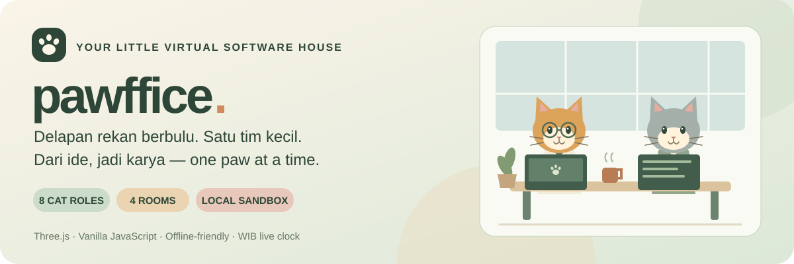

<p align="center">
  
</p>

<h1 align="center">🐾 Pawffice</h1>

<p align="center">
  <strong>A little room for big ideas.</strong><br>
  Delapan rekan berbulu. Empat ruangan. Satu software house kecil.
</p>

<p align="center">
  🟢 Lokal &amp; offline-friendly · 🟠 Three.js · 🟣 Tanpa backend · 🐱 8 role
</p>

---

## 🌱 Selamat datang di kantor

Simulasi kantor 3D lokal untuk sebuah software house kecil yang menerima
proyek pembuatan sistem berbasis website. Semua aktivitas, karakter, dan
progres quest berjalan di browser tanpa backend atau koneksi AI.

> 🧶 **Masih sandbox, belum AI agent sungguhan.**
> Kegiatan coding dan pengujian proyek masih berupa status simulasi, bukan
> file website yang dihasilkan model AI.

| | Yang menunggu di dalam |
| :---: | --- |
| 🐈 | Avatar kucing berseragam, role, dan jobdesk masing-masing. |
| 🏢 | Ruang kerja, ruang meeting, ruang Owner + PA, serta pantry. |
| ☕ | Coffee break, istirahat bersama, dan rapat di meja panjang. |
| 📋 | Project Hub: brief klien, papan tugas, dokumen, dan review per role. |
| 🎯 | Progres berbasis tugas yang disetujui dan tiga quest sampingan harian. |
| 🗂️ | Arsip proyek, notulen rapat, unduhan Markdown, dan cadangan JSON. |
| 🌙 | Jam WIB live, siang/malam otomatis, dan penyimpanan lokal. |

## 🚀 Cara membuka

Klik dua kali `3D-index.html`, lalu buka dengan Chrome atau Edge.
Semua library sudah disimpan lokal. Tidak perlu instalasi, Node.js,
backend, akun AI, atau koneksi internet untuk menjalankan simulasi.

Sudah memakai Live Server? Lanjutkan dari alamat yang biasanya kamu buka.

> 💾 **Gunakan browser, profil, dan alamat yang sama agar progres terbaca.**
> `file:///...`, `http://localhost:5500`, dan `http://127.0.0.1:5500` memiliki
> penyimpanan berbeda. Setelah edit kode, refresh tab yang sama; bila perlu
> gunakan **Ctrl + Shift + R**.

## 🌱 Mulai dari Project Hub

Klik **📋 Project Hub** di panel kiri, tombol **Buka Project Hub** pada panel
proyek, atau tekan **P**. Area dokumen dibuka terpisah dari kantor 3D.

| Tab | Yang bisa dilakukan |
| --- | --- |
| 🌱 **Brief** | Isi nama proyek, klien, jenis website, tujuan, fitur, dan target tanggal opsional. |
| 📋 **Papan tugas** | Mulai tugas, buat draf template, edit dokumen, lalu review hasil. |
| 🤝 **Notulen** | Baca catatan Sasa dan tindak lanjut yang mengacu ke tugas tim. |
| 🗂️ **Arsip** | Simpan proyek selesai/berjalan, baca dokumen, dan lanjutkan proyek lama. |
| 💾 **Cadangan** | Ekspor seluruh progres sebagai JSON atau pulihkan cadangan yang valid. |

Satu proyek aktif dalam satu waktu. Untuk klien baru, arsipkan proyek aktif
dahulu. Arsip parsial tidak menghapus hasil kerja dan dapat dilanjutkan.
Instalasi baru dimulai tanpa proyek; contoh barbershop hanya dibawa jika ada
progres dari versi lama. Brief memuat 1–20 kebutuhan, satu kebutuhan per baris.

### 📋 Alur tugas yang menghasilkan dokumen

**Belum mulai → Dikerjakan → Review → Selesai.**

1. Pilih kartu tugas dan klik **Mulai tugas** jika prasyaratnya selesai.
2. Klik **Buat draf template**. Isi dokumen dibuat dari brief secara lokal.
3. Perbaiki teks bila perlu, lalu **Simpan draf / ajukan review**.
4. Periksa seluruh checklist sebelum **Setujui hasil**.
5. Bila belum sesuai, gunakan **Minta revisi**. Dokumen yang berubah mengulang
   checklist review; dokumen final dikunci agar tugas turunannya konsisten.

Review dilakukan **manual oleh pengguna sebagai pengelola simulasi**.
Pemilihan avatar tidak menjadi autentikasi reviewer. Draf yang belum disimpan
tidak dihapus oleh refresh otomatis panel; keluar tab/dialog meminta konfirmasi.
Konfirmasi memakai modal Pawffice bertema sage/cream, bukan popup browser.
Arsip proyek, penggantian progres, dan meninggalkan draf memiliki pesan serta
tombol sesuai tindakan. Fokus awal berada pada tombol batal; Escape, tombol ×,
atau klik backdrop membatalkan tanpa menerapkan tindakan tersebut.

> 🪄 Hasilnya adalah **dokumen template simulasi**, bukan website, desain gambar,
> API yang sudah berjalan, atau bukti pengujian nyata. Dokumen QA secara eksplisit
> menyatakan pengujian belum dijalankan pada website nyata. Belum ada panggilan AI.

## 🐾 Kenalan dengan tim

| Anggota | Role | Tanggung jawab di simulasi |
| --- | --- | --- |
| 📋 **Miko** | Project Manager | Menentukan lingkup dan mengatur progres proyek. |
| 🔎 **Nori** | System Analyst | Mencatat kebutuhan klien dan alur sistem. |
| 🎨 **Luna** | UI/UX Designer | Merancang alur penggunaan dan tampilan. |
| 🧩 **Kiko** | Frontend Developer | Membangun halaman dan interaksi website. |
| 🗄️ **Bimo** | Backend Developer | Menyiapkan logika, jadwal, dan reservasi. |
| 🧪 **Piko** | QA / Tester | Menguji alur booking dan menyiapkan serah-terima. |
| 👑 **Oji** | Owner / Founder | Menentukan arah layanan dan meninjau keputusan proyek. |
| 🗓️ **Sasa** | Personal Assistant / Secretary | Mengatur agenda, komunikasi klien, dan catatan rapat. |

Semua anggota divisualisasikan sebagai avatar kucing berseragam. Untuk
memilih karakter, klik kartu tim atau tekan angka 1–8.

Tombol **Lihat jobdesk tim** (atau J) membuka seluruh tanggung jawab tanpa
perlu memilih avatar. Label nama/role menempel di atas avatar dan mengikuti
gerakan serta kamera, tanpa dipindah untuk menghindari label lain. Ukurannya
mengikuti zoom dengan batas saat close-up. Avatar di luar pandangan tidak
meninggalkan label di tepi layar. Papan role fisik tetap ada di setiap bilik.
Untuk membaca detail saat zoom terlalu jauh, gunakan daftar jobdesk tim.

<details>
  <summary>📚 Buka jobdesk lengkap delapan aktor</summary>

### Siapa mengerjakan apa?

- **Miko — Project Manager:** menetapkan scope, prioritas, dan jadwal;
  membagi pekerjaan serta memantau hambatan; mengkoordinasikan review klien.
- **Nori — System Analyst:** menggali kebutuhan dan spesifikasi;
  menyusun proses, use case, dan rancangan data; menjelaskan aturan bisnis.
- **Luna — UI/UX Designer:** merancang user flow, wireframe, dan prototipe;
  menentukan komponen visual; menyerahkan dan meninjau implementasi desain.
- **Kiko — Frontend Developer:** membangun halaman responsif;
  mengerjakan interaksi pengguna; menghubungkan UI ke API dan memperbaiki bug.
- **Bimo — Backend Developer:** merancang database dan API;
  menerapkan validasi, autentikasi, dan aturan bisnis; menjaga integrasi data.
- **Piko — QA / Tester:** menyusun skenario uji; menguji dan mencatat bug;
  menguji ulang perbaikan serta memeriksa kesiapan serah-terima.
- **Oji — Owner / Founder:** menentukan arah bisnis dan layanan;
  meninjau klien, sumber daya, dan keputusan penting; menyetujui proposal/hasil.
- **Sasa — Personal Assistant / Secretary:** mengatur agenda dan pengingat;
  mencatat serta menindaklanjuti rapat; mengelola komunikasi dan dokumen klien.

Jobdesk ini menjelaskan peran aktor dalam simulasi dan arah pengembangan
software house; kegiatan coding dan pengujian proyek masih berupa simulasi.

</details>

## 🎮 Kontrol kecil, banyak cerita

- Seret area 3D untuk memutar kamera.
- Gulir mouse atau cubit layar sentuh untuk zoom.
- Klik karakter atau kartu tim untuk memilihnya.
- Lihat lebih dekat: kamera mengikuti karakter terpilih.
- Overview atau tombol R/Escape: kembali ke kamera awal.
- Coffee break: ajak karakter terpilih ke area kopi.
- Team huddle: ajak seluruh tim berdiskusi di meja meeting panjang.
- Tombol bulan/matahari: ganti suasana siang dan malam secara manual.
  Pilihan manual berlaku sampai halaman dimuat ulang.
- Tombol jeda atau Spasi: hentikan/lanjutkan aktivitas karakter.
  Jam Jakarta tetap berjalan.
- Tombol 1×: ganti kecepatan aktivitas 1×, 2×, dan 4×.
  Kecepatan ini tidak mengubah jam Jakarta.
- Tombol angka 1–8: pilih anggota tim sesuai urutan kartu.
- Lihat jobdesk tim atau tombol J: buka daftar tanggung jawab delapan role.
  Tutup dengan tombol ×, Escape, atau klik di luar daftar.
- Project Hub atau tombol P: kelola brief, tugas, hasil kerja, arsip, dan cadangan.
  Saat mengisi form atau membuka dialog, shortcut kantor tidak mengganggu input.
- Menu **Lokasi kantor** di panel kiri: pilih Semua ruangan, Ruang kerja,
  Meeting, Owner + PA, atau Pantry & istirahat. Menu menutup setelah dipilih.

UI memakai font sans-serif lokal (Aptos/Segoe UI/system font), dengan teks
utama 14–15 px dan keterangan kecil minimal 12 px. Tidak perlu mengunduh
font dari internet. Pilihan lokasi tidak menutupi area 3D.

## 🏡 Keliling kantor

| Ruangan | Posisi | Kegiatan |
| --- | --- | --- |
| 💻 **Ruang kerja** | Kiri belakang | PM, analis, designer, FE, BE, dan QA bekerja. |
| 🤝 **Meeting** | Kanan belakang | Delapan rekan rapat di meja panjang. |
| 🌿 **Owner + PA** | Kanan depan | Oji dan Sasa mengatur arah serta agenda tim. |
| ☕ **Pantry & istirahat** | Kiri depan | Ngopi, duduk santai, dan mengisi energi. |

Enam meja produksi tersusun simetris dalam dua baris berisi tiga bilik.
Baris pertama berisi PM (Miko), System Analyst (Nori), dan UI/UX Designer
(Luna). Baris kedua berisi Frontend (Kiko), Backend (Bimo), dan QA (Piko).
Denah kantor berbentuk persegi panjang memanjang, sekitar 38,8 × 22,8 unit
dunia. Empat ruangan dipisahkan sekat kaca dengan pintu selebar empat unit:
ruang kerja di kiri belakang, pantry di kiri depan, ruang meeting di kanan
belakang, dan ruang Owner + PA di kanan depan. Meja Oji dan Sasa berada di
ruang Owner. Setiap ruangan diperluas, dengan jarak bilik dan lorong lega.
Monitor dan keyboard lurus mengikuti meja; kursi dan avatar berbagi titik
duduk serta arah hadap yang sama. Panel bilik memakai sage dan sand lembut.
Pantry adalah ruangan khusus berisi coffee corner, kulkas, sofa panjang,
dan dua meja istirahat dengan delapan kursi. Avatar yang beristirahat duduk
di kursi pantry masing-masing. Ruang meeting memiliki meja panjang delapan
kursi (tiga pada tiap sisi panjang dan satu pada tiap ujung), layar presentasi,
dan lorong di sekeliling meja. Ruang Owner punya dua meja dan lemari penyimpanan.

Karakter menghitung jalur yang menghindari dinding, furnitur, kursi milik karakter
lain, dan posisi karakter lain. Jika jalurnya terhalang saat berjalan,
karakter mencari rute baru. Saat benar-benar perlu menunggu, animasi kaki
ikut berhenti.

Pada Team huddle, setiap karakter melewati pintu menuju kursi rapatnya sendiri,
duduk menghadap meja, lalu menunggu temannya sebelum waktu diskusi dihitung.
Setelah seluruh tim berkumpul, Sasa menyimpan satu notulen template untuk
pertemuan tersebut pada proyek aktif. Catatan berisi progres dan tindak lanjut
ke tugas yang belum selesai; status tugas pada daftar tindak lanjut mengikuti
papan tugas. Ini bukan transkrip percakapan AI. Notulen juga ikut diarsipkan
dan disertakan dalam unduhan dokumen proyek.

Panel kiri bisa digulir ketika tinggi jendela tidak cukup. Cerita hari ini
tetap berada di dalam panel dan tidak menimpa toolbar bawah. Pada layar
tablet/ponsel, cerita juga ditampilkan dan dapat dibaca lewat gulir halaman.

## 🎯 Dari brief sampai siap diuji

Proyek utama mengikuti **brief klien yang kamu buat**, bukan satu judul
yang dikunci di kode. Progres adalah jumlah tugas berstatus **Selesai** dibagi
delapan tugas. Waktu duduk, kecepatan simulasi, dan timer 30 detik tidak lagi
menyelesaikan tugas proyek secara otomatis. Setiap persetujuan tugas memberi
25 happiness sekali; migrasi, reload, dan melanjutkan arsip tidak memberi ulang hadiah.

| Tahap | Penanggung jawab | Fokus |
| :---: | --- | --- |
| 1 | 📋 Miko | Scope proyek dan rencana kerja. |
| 2 | 🔎 Nori | Spesifikasi kebutuhan setelah scope disetujui. |
| 3 | 🎨 Luna | Rancangan UI/UX tertulis setelah analisis. |
| 4 | 🧩 Kiko | Rencana frontend setelah rancangan UI/UX. |
| 5 | 🗄️ Bimo | Rencana backend setelah analisis; bisa paralel dengan desain/FE. |
| 6 | 🧪 Piko | Skenario uji setelah rencana FE dan BE disetujui. |
| 7 | 🗓️ Sasa | Ringkasan serah-terima setelah dokumen QA. |
| 8 | 👑 Oji | Review akhir dan persetujuan simulasi. |

Tiga quest sampingan dipilih dari rotasi harian. Pilihan dan progresnya
tetap sama setelah refresh pada hari yang sama, lalu berganti saat tanggal
WIB berubah. Quest dapat meminta tim fokus, istirahat, rapat, berkolaborasi,
atau memilih rekan. Setiap quest sampingan yang selesai memberi 10 office
happiness. Progres proyek utama dan happiness berlanjut lintas hari.
Quest **Majukan proyek** berarti menyetujui satu tugas. Jika tidak ada proyek
aktif atau semua tugas sudah selesai dan quest itu belum dapat dipenuhi,
quest tersebut diganti dengan kegiatan harian lain. Dua pilihan lain tetap
stabil; quest yang sudah selesai tidak ditarik atau diberi hadiah ulang.

### 💾 Progres tidak perlu mulai dari nol

Brief, tugas, dokumen, notulen, arsip, anggota tim yang dikenal,
quest harian, serta happiness disimpan otomatis di localStorage browser.
Membuka ulang halaman pada browser, profil, dan alamat yang sama memulihkan
progres. Data versi lama dimigrasikan saat tersedia. Aktivitas tidak berjalan
selama tab ditutup.

Penyimpanan baru memakai `pawffice.progress.v3`; simpanan v1/v2 tidak dihapus.
Tahap lama yang sudah selesai dibawa ke tugas baru. Proyek lama yang sudah
100% tetap 100%, disertai catatan bahwa status berasal dari simulasi timer lama.
Sisa detik tahap lama dicatat di brief, bukan dipakai untuk mengesahkan dokumen.
Pada proyek parsial, persentase mengikuti delapan tugas baru; jumlah tahap
lama yang sudah selesai tetap dipertahankan. Jika simpanan rusak, aplikasi
tidak otomatis menimpanya dengan data kosong.

### 💾 Ekspor, impor, dan unduh hasil

- **Brief / Arsip → Unduh dokumen .md:** seluruh hasil kerja dan notulen proyek.
- **Cadangan → Unduh cadangan JSON:** simpanan proyek aktif, arsip, quest,
  anggota yang dikenal, dan happiness. Posisi kamera/avatar bukan bagian backup.
- **Cadangan → pilih JSON:** format dan isi divalidasi sebelum preview ditampilkan.
  File yang salah tidak menyentuh progres aktif. Batas impor adalah 16 MB.
- **Ganti progres:** perlu konfirmasi karena mengganti seluruh simpanan lokal,
  bukan menggabungkan data. Unduh cadangan kondisi sekarang terlebih dahulu.
- Jika browser menolak penyimpanan atau kapasitasnya habis, data masih ada di
  memori tab; ekspor JSON sebelum menutupnya. Simpan backup secara pribadi
  bila brief atau dokumen memuat informasi klien.

Batas pengaman saat ini: 100 arsip dan 100 notulen per proyek. Tidak ada data
yang dikirim ke server. Jam, animasi, dan pilihan suasana bukan hasil proyek.

Penyimpanan berlaku di browser/profil dan alamat halaman yang sama.
Menghapus data situs, memakai mode privat, atau memindahkan file lokal
dapat menghasilkan penyimpanan yang berbeda. Perilaku localStorage untuk
file HTML yang dibuka langsung bergantung pada browser. Jika penyimpanan
ditolak, panel misi menampilkan status bahwa progres masih sementara.

## 🕰️ Satu kantor, satu jam Jakarta

Jam digital, tanggal, cap waktu aktivitas, dan jarum jam dinding mengikuti
zona waktu Asia/Jakarta (WIB, UTC+7). Jam menggunakan waktu komputer dan
tidak memerlukan koneksi internet. Pastikan jam komputer sudah benar.

Pause dan tombol kecepatan hanya memengaruhi aktivitas karakter.
Saat membuka halaman, suasana otomatis mengikuti WIB: malam pukul
18.00–05.59, dan siang pukul 06.00–17.59. Tombol bulan/matahari tetap
bisa digunakan untuk mencoba suasana lain.

| 🌤️ Siang | 🌙 Malam |
| :---: | :---: |
| 06.00–17.59 WIB | 18.00–05.59 WIB |

## 🧰 Di balik meja

### 🗂️ Susunan folder proyek

```text
3D-Office-Ai/
├── 3D-index.html                          # Halaman utama tetap di alamat lama
├── index.html                             # Pintasan ke 3D-index.html
├── README.md                              # Panduan proyek dan penggunaan
├── .gitattributes                         # Normalisasi file teks Git
├── .gitignore                             # Abaikan file sementara dan hasil QA
├── src/
│   ├── css/
│   │   └── style.css                      # Tema dan layout responsif
│   └── js/
│       ├── main.js                        # Kantor 3D dan penghubung aplikasi
│       └── projects/
│           ├── project-engine.js          # Aturan dan data proyek
│           └── project-ui.js              # Antarmuka Project Hub
├── vendor/
│   └── three/
│       ├── Three.js                       # Library Three.js lokal
│       └── THREE-LICENSE.txt              # Lisensi library
├── assets/
│   └── images/
│       └── readme-banner.svg              # Ilustrasi dokumentasi
├── docs/
│   ├── CHANGELOG.md                        # Riwayat pengembangan
│   ├── Ringkasan_Fitur_dan_Alur_Pawffice.docx
│   └── notes/
│       └── Catatan Pengembangan AI.txt     # Catatan rencana pengembangan
├── tests/
│   ├── project-engine.test.cjs             # Tes aturan proyek
│   ├── project-ui.test.cjs                 # Tes handler dan modal UI
│   ├── project-structure.test.cjs          # Tes path dan struktur proyek
│   └── office-integration.cjs              # Tes integrasi dan gerak kantor
└── tools/
    └── docs/
        └── build-summary.py               # Alat bantu pembuatan dokumen Word
```

Folder `tools/docs/.qa/` dapat berisi hasil pemeriksaan dokumen lokal dan
diabaikan oleh Git. Folder `.git/` adalah metadata repositori, bukan kode aplikasi.

### 🧩 Fungsi tiap kelompok

| Kelompok | Isi dan tanggung jawab |
| --- | --- |
| `src/css/` | Warna, font, panel, dialog, dan tampilan responsif. |
| `src/js/main.js` | Avatar, ruangan, animasi, navigasi, kamera, quest harian, serta penyimpanan dan integrasi Project Hub. |
| `src/js/projects/` | Aturan brief, dependensi, hasil kerja, migrasi, validasi, serta antarmuka pengelolaan proyek. |
| `vendor/three/` | Library pihak ketiga beserta lisensinya; terpisah dari kode yang kita kembangkan. |
| `assets/images/` | Gambar dan ilustrasi lokal. |
| `docs/` | Dokumentasi, ringkasan Word, dan catatan pengembangan. |
| `tests/` | Pengujian aturan, handler UI, struktur file, dan model kantor. |
| `tools/docs/` | Skrip bantu dokumentasi; tidak dimuat saat kantor dibuka. |

Halaman utama **tidak dipindahkan**: tetap buka `3D-index.html` pada browser,
profil, host, dan port yang sama. Penataan folder tidak mengubah kunci localStorage
atau mereset proyek. Tidak ada backend, bundler, atau instalasi baru.

HTML memuat file dengan urutan: library Three.js, engine proyek, UI proyek,
kemudian `main.js`. Path stylesheet, gambar README, lisensi, dan tes sudah
disesuaikan ke lokasi baru. Jangan membuka file JavaScript sebagai halaman utama.

Data karakter dan quest berada di bagian atas `src/js/main.js`. Model kucing,
meja, serta furnitur dibuat dari kode; tidak membutuhkan file model
eksternal. Progres quest saat ini mengikuti aturan simulasi JavaScript.
Role belum menjalankan model AI atau mengirim permintaan API.

### 🧭 Rencana pemisahan metode

Logika Waterfall, Agile, dan Hybrid **belum ditambahkan**. Untuk pengembangan
berikutnya, modul metode dapat ditempatkan di `src/js/projects/methods/`
dengan file `waterfall.js`, `agile.js`, dan `hybrid.js`. Folder dan modul ini
belum menjadi bagian aplikasi saat ini; `project-engine.js` nantinya bertindak
sebagai penghubung ke metode yang dipilih dalam brief.

### 🧪 Pemeriksaan pengembangan (opsional)

Node.js **hanya untuk menjalankan tes**, tidak diperlukan untuk membuka kantor.
Tidak ada paket tambahan atau proses build yang harus diinstal.

```powershell
node --test tests/project-engine.test.cjs tests/project-ui.test.cjs tests/project-structure.test.cjs
node tests/office-integration.cjs
```

Tes UI memakai DOM tiruan untuk memeriksa handler/state dan tes kantor memakai
model Three.js tanpa rendering. Keduanya bukan pengganti pemeriksaan visual
browser untuk tata letak, fokus keyboard, dan interaksi sentuh.

Banner memakai SVG lokal dan ikon dokumentasi memakai emoji, tanpa layanan
badge atau gambar eksternal. Warnanya tetap tampil saat dibaca offline.

📦 Library: [Three.js](https://threejs.org/) ·
[Repositori Three.js](https://github.com/mrdoob/three.js) ·
[Lisensi library](vendor/three/THREE-LICENSE.txt) ·
[Catatan pengembangan](docs/CHANGELOG.md) ·
[Ringkasan Word](docs/Ringkasan_Fitur_dan_Alur_Pawffice.docx)

---

<p align="center">
  🐾 <strong>One paw at a time.</strong><br>
  Kerja pelan-pelan, kopi tetap hangat. ☕
</p>
