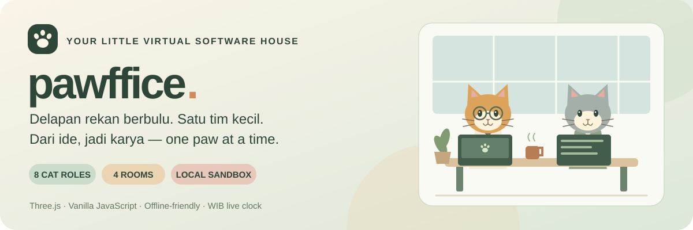

  

<h1 align="center">🐾 Pawffice</h1>

  <strong>A little room for big ideas.</strong> 
  Delapan rekan berbulu. Empat ruangan. Satu software house kecil.

  🟢 Lokal &amp; offline-friendly · 🟠 Three.js · 🟣 Tanpa backend · 🐱 8 role

---

## 🌱 Selamat datang di kantor

Simulasi kantor 3D lokal untuk sebuah software house kecil yang menerima
proyek pembuatan sistem berbasis website. Semua aktivitas, karakter, dan
progres quest berjalan di browser tanpa backend atau koneksi AI.

> 🧶 **Masih sandbox, belum AI agent sungguhan.**
> Kegiatan coding dan pengujian proyek masih berupa status simulasi, bukan
> file website yang dihasilkan model AI.

| | Yang menunggu di dalam |
| :---: | --- |
| 🐈 | Avatar kucing berseragam, role, dan jobdesk masing-masing. |
| 🏢 | Ruang kerja, ruang meeting, ruang Owner + PA, serta pantry. |
| ☕ | Coffee break, istirahat bersama, dan rapat di meja panjang. |
| 🎯 | Progres proyek utama dan tiga quest sampingan harian. |
| 🌙 | Jam WIB live, siang/malam otomatis, dan penyimpanan lokal. |

## 🚀 Cara membuka

Klik dua kali `3D-index.html`, lalu buka dengan Chrome atau Edge.
Semua library sudah disimpan lokal. Tidak perlu instalasi, Node.js,
backend, akun AI, atau koneksi internet untuk menjalankan simulasi.

Sudah memakai Live Server? Lanjutkan dari alamat yang biasanya kamu buka.

> 💾 **Gunakan browser, profil, dan alamat yang sama agar progres terbaca.**
> `file:///...`, `http://localhost:5500`, dan `http://127.0.0.1:5500` memiliki
> penyimpanan berbeda. Setelah edit kode, refresh tab yang sama; bila perlu
> gunakan **Ctrl + Shift + R**.

## 🐾 Kenalan dengan tim

| Anggota | Role | Tanggung jawab di simulasi |
| --- | --- | --- |
| 📋 **Miko** | Project Manager | Menentukan lingkup dan mengatur progres proyek. |
| 🔎 **Nori** | System Analyst | Mencatat kebutuhan klien dan alur sistem. |
| 🎨 **Luna** | UI/UX Designer | Merancang alur penggunaan dan tampilan. |
| 🧩 **Kiko** | Frontend Developer | Membangun halaman dan interaksi website. |
| 🗄️ **Bimo** | Backend Developer | Menyiapkan logika, jadwal, dan reservasi. |
| 🧪 **Piko** | QA / Tester | Menguji alur booking dan menyiapkan serah-terima. |
| 👑 **Oji** | Owner / Founder | Menentukan arah layanan dan meninjau keputusan proyek. |
| 🗓️ **Sasa** | Personal Assistant / Secretary | Mengatur agenda, komunikasi klien, dan catatan rapat. |

Semua anggota divisualisasikan sebagai avatar kucing berseragam. Untuk
memilih karakter, klik kartu tim atau tekan angka 1–8.

Tombol **Lihat jobdesk tim** (atau J) membuka seluruh tanggung jawab tanpa
perlu memilih avatar. Label nama/role menempel di atas avatar dan mengikuti
gerakan serta kamera, tanpa dipindah untuk menghindari label lain. Ukurannya
mengikuti zoom dengan batas saat close-up. Avatar di luar pandangan tidak
meninggalkan label di tepi layar. Papan role fisik tetap ada di setiap bilik.
Untuk membaca detail saat zoom terlalu jauh, gunakan daftar jobdesk tim.

  
📚 Buka jobdesk lengkap delapan aktor

### Siapa mengerjakan apa?

- **Miko — Project Manager:** menetapkan scope, prioritas, dan jadwal;
  membagi pekerjaan serta memantau hambatan; mengkoordinasikan review klien.
- **Nori — System Analyst:** menggali kebutuhan dan spesifikasi;
  menyusun proses, use case, dan rancangan data; menjelaskan aturan bisnis.
- **Luna — UI/UX Designer:** merancang user flow, wireframe, dan prototipe;
  menentukan komponen visual; menyerahkan dan meninjau implementasi desain.
- **Kiko — Frontend Developer:** membangun halaman responsif;
  mengerjakan interaksi pengguna; menghubungkan UI ke API dan memperbaiki bug.
- **Bimo — Backend Developer:** merancang database dan API;
  menerapkan validasi, autentikasi, dan aturan bisnis; menjaga integrasi data.
- **Piko — QA / Tester:** menyusun skenario uji; menguji dan mencatat bug;
  menguji ulang perbaikan serta memeriksa kesiapan serah-terima.
- **Oji — Owner / Founder:** menentukan arah bisnis dan layanan;
  meninjau klien, sumber daya, dan keputusan penting; menyetujui proposal/hasil.
- **Sasa — Personal Assistant / Secretary:** mengatur agenda dan pengingat;
  mencatat serta menindaklanjuti rapat; mengelola komunikasi dan dokumen klien.

Jobdesk ini menjelaskan peran aktor dalam simulasi dan arah pengembangan
software house; kegiatan coding dan pengujian proyek masih berupa simulasi.

## 🎮 Kontrol kecil, banyak cerita

- Seret area 3D untuk memutar kamera.
- Gulir mouse atau cubit layar sentuh untuk zoom.
- Klik karakter atau kartu tim untuk memilihnya.
- Lihat lebih dekat: kamera mengikuti karakter terpilih.
- Overview atau tombol R/Escape: kembali ke kamera awal.
- Coffee break: ajak karakter terpilih ke area kopi.
- Team huddle: ajak seluruh tim berdiskusi di meja meeting panjang.
- Tombol bulan/matahari: ganti suasana siang dan malam secara manual.
  Pilihan manual berlaku sampai halaman dimuat ulang.
- Tombol jeda atau Spasi: hentikan/lanjutkan aktivitas karakter.
  Jam Jakarta tetap berjalan.
- Tombol 1×: ganti kecepatan aktivitas 1×, 2×, dan 4×.
  Kecepatan ini tidak mengubah jam Jakarta.
- Tombol angka 1–8: pilih anggota tim sesuai urutan kartu.
- Lihat jobdesk tim atau tombol J: buka daftar tanggung jawab delapan role.
  Tutup dengan tombol ×, Escape, atau klik di luar daftar.
- Menu **Lokasi kantor** di panel kiri: pilih Semua ruangan, Ruang kerja,
  Meeting, Owner + PA, atau Pantry & istirahat. Menu menutup setelah dipilih.

UI memakai font sans-serif lokal (Aptos/Segoe UI/system font), dengan teks
utama 14–15 px dan keterangan kecil minimal 12 px. Tidak perlu mengunduh
font dari internet. Pilihan lokasi tidak menutupi area 3D.

## 🏡 Keliling kantor

| Ruangan | Posisi | Kegiatan |
| --- | --- | --- |
| 💻 **Ruang kerja** | Kiri belakang | PM, analis, designer, FE, BE, dan QA bekerja. |
| 🤝 **Meeting** | Kanan belakang | Delapan rekan rapat di meja panjang. |
| 🌿 **Owner + PA** | Kanan depan | Oji dan Sasa mengatur arah serta agenda tim. |
| ☕ **Pantry & istirahat** | Kiri depan | Ngopi, duduk santai, dan mengisi energi. |

Enam meja produksi tersusun simetris dalam dua baris berisi tiga bilik.
Baris pertama berisi PM (Miko), System Analyst (Nori), dan UI/UX Designer
(Luna). Baris kedua berisi Frontend (Kiko), Backend (Bimo), dan QA (Piko).
Denah kantor berbentuk persegi panjang memanjang, sekitar 38,8 × 22,8 unit
dunia. Empat ruangan dipisahkan sekat kaca dengan pintu selebar empat unit:
ruang kerja di kiri belakang, pantry di kiri depan, ruang meeting di kanan
belakang, dan ruang Owner + PA di kanan depan. Meja Oji dan Sasa berada di
ruang Owner. Setiap ruangan diperluas, dengan jarak bilik dan lorong lega.
Monitor dan keyboard lurus mengikuti meja; kursi dan avatar berbagi titik
duduk serta arah hadap yang sama. Panel bilik memakai sage dan sand lembut.
Pantry adalah ruangan khusus berisi coffee corner, kulkas, sofa panjang,
dan dua meja istirahat dengan delapan kursi. Avatar yang beristirahat duduk
di kursi pantry masing-masing. Ruang meeting memiliki meja panjang delapan
kursi (tiga pada tiap sisi panjang dan satu pada tiap ujung), layar presentasi,
dan lorong di sekeliling meja. Ruang Owner punya dua meja dan lemari penyimpanan.

Karakter menghitung jalur yang menghindari dinding, furnitur, kursi milik karakter
lain, dan posisi karakter lain. Jika jalurnya terhalang saat berjalan,
karakter mencari rute baru. Saat benar-benar perlu menunggu, animasi kaki
ikut berhenti.

Pada Team huddle, setiap karakter melewati pintu menuju kursi rapatnya sendiri,
duduk menghadap meja, lalu menunggu temannya sebelum waktu diskusi dihitung.

Panel kiri bisa digulir ketika tinggi jendela tidak cukup. Cerita hari ini
tetap berada di dalam panel dan tidak menimpa toolbar bawah. Pada layar
tablet/ponsel, cerita juga ditampilkan dan dapat dibaca lewat gulir halaman.

## 🎯 Dari brief sampai siap diuji

Quest utama Pawffice adalah menyelesaikan **sistem booking online untuk
barbershop fiktif**. Progres ditampilkan sebagai persentase dan mengikuti
enam tahap kerja: Miko menentukan lingkup, Nori merangkum kebutuhan, Luna
merancang alur dan tampilan, Kiko membangun halaman, Bimo menyiapkan jadwal
serta reservasi, lalu Piko menguji hasilnya. Tahap role yang bersangkutan
maju saat ia bekerja selama 30 detik waktu simulasi. Satu tahap memberi
25 office happiness. Owner dan PA mendukung arah layanan, koordinasi klien,
dan agenda tim melalui aktivitas harian mereka.

| Tahap | Penanggung jawab | Fokus |
| :---: | --- | --- |
| 1 | 📋 Miko | Tentukan lingkup proyek. |
| 2 | 🔎 Nori | Rangkum kebutuhan pelanggan. |
| 3 | 🎨 Luna | Rancang alur dan tampilan. |
| 4 | 🧩 Kiko | Bangun halaman pemesanan. |
| 5 | 🗄️ Bimo | Siapkan jadwal dan reservasi. |
| 6 | 🧪 Piko | Uji alur dan siapkan serah-terima. |

Tiga quest sampingan dipilih dari rotasi harian. Pilihan dan progresnya
tetap sama setelah refresh pada hari yang sama, lalu berganti saat tanggal
WIB berubah. Quest dapat meminta tim fokus, istirahat, rapat, berkolaborasi,
atau memilih rekan. Setiap quest sampingan yang selesai memberi 10 office
happiness. Progres proyek utama dan happiness berlanjut lintas hari.

### 💾 Progres tidak perlu mulai dari nol

Status proyek, tahap yang sedang dikerjakan, anggota tim yang dikenal,
quest harian, serta happiness disimpan otomatis di localStorage browser.
Membuka ulang halaman pada browser, profil, dan alamat yang sama memulihkan
progres. Data versi lama dimigrasikan saat tersedia. Aktivitas tidak berjalan
selama tab ditutup.

Penyimpanan berlaku di browser/profil dan alamat halaman yang sama.
Menghapus data situs, memakai mode privat, atau memindahkan file lokal
dapat menghasilkan penyimpanan yang berbeda. Perilaku localStorage untuk
file HTML yang dibuka langsung bergantung pada browser. Jika penyimpanan
ditolak, panel misi menampilkan status bahwa progres masih sementara.

## 🕰️ Satu kantor, satu jam Jakarta

Jam digital, tanggal, cap waktu aktivitas, dan jarum jam dinding mengikuti
zona waktu Asia/Jakarta (WIB, UTC+7). Jam menggunakan waktu komputer dan
tidak memerlukan koneksi internet. Pastikan jam komputer sudah benar.

Pause dan tombol kecepatan hanya memengaruhi aktivitas karakter.
Saat membuka halaman, suasana otomatis mengikuti WIB: malam pukul
18.00–05.59, dan siang pukul 06.00–17.59. Tombol bulan/matahari tetap
bisa digunakan untuk mencoba suasana lain.

| 🌤️ Siang | 🌙 Malam |
| :---: | :---: |
| 06.00–17.59 WIB | 18.00–05.59 WIB |

## 🧰 Di balik meja

- `3D-index.html`: struktur halaman dan tombol.
- `style.css`: warna, panel, dan tampilan responsif.
- `main.js`: data delapan role, dunia 3D, animasi, navigasi, serta quest utama
  dan sampingan.
- `Three.js`: library Three.js r160 versi tidak dipadatkan.
- `THREE-LICENSE.txt`: lisensi MIT library Three.js.
- `index.html`: pintasan menuju halaman utama.
- `assets/readme-banner.svg`: banner dokumentasi berwarna sage/cream.

Data karakter dan quest berada di bagian atas `main.js`. Model kucing,
meja, serta furnitur dibuat dari kode; tidak membutuhkan file model
eksternal. Progres quest saat ini mengikuti aturan simulasi JavaScript.
Role belum menjalankan model AI atau mengirim permintaan API.

Banner memakai SVG lokal dan ikon dokumentasi memakai emoji, tanpa layanan
badge atau gambar eksternal. Warnanya tetap tampil saat dibaca offline.

📦 Library: [Three.js](https://threejs.org/) ·
[Repositori Three.js](https://github.com/mrdoob/three.js) ·
[Lisensi library](THREE-LICENSE.txt)

---

  🐾 <strong>One paw at a time.</strong> 
  Kerja pelan-pelan, kopi tetap hangat. ☕

